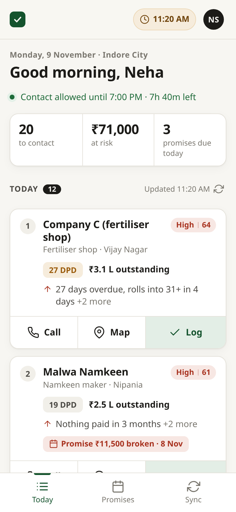
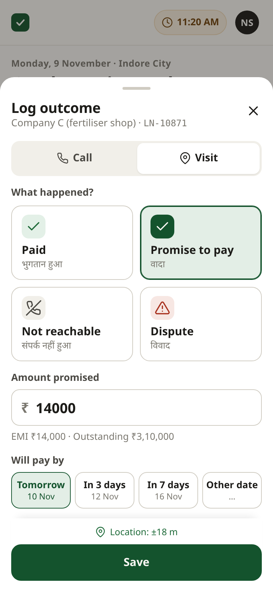
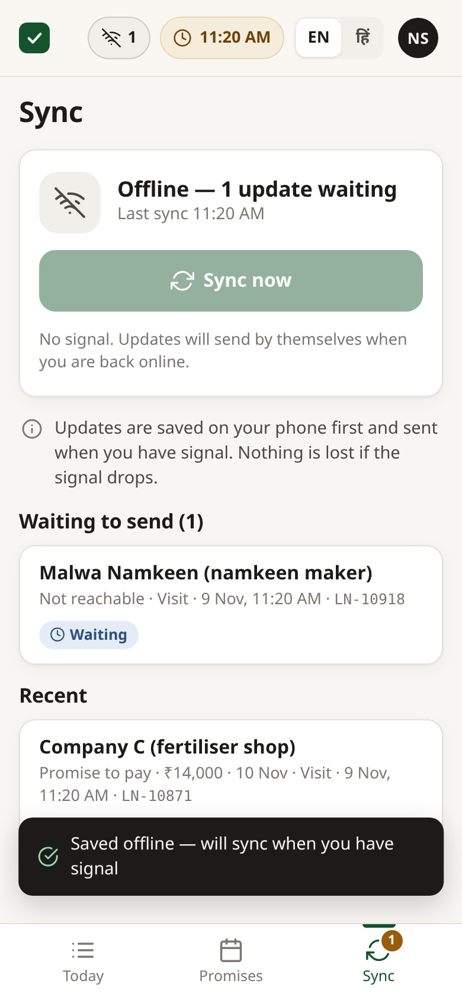
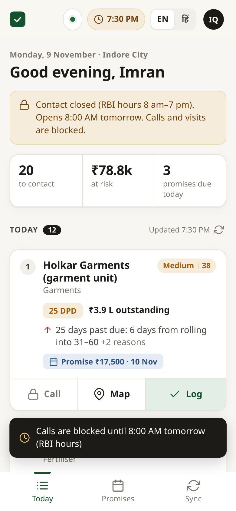
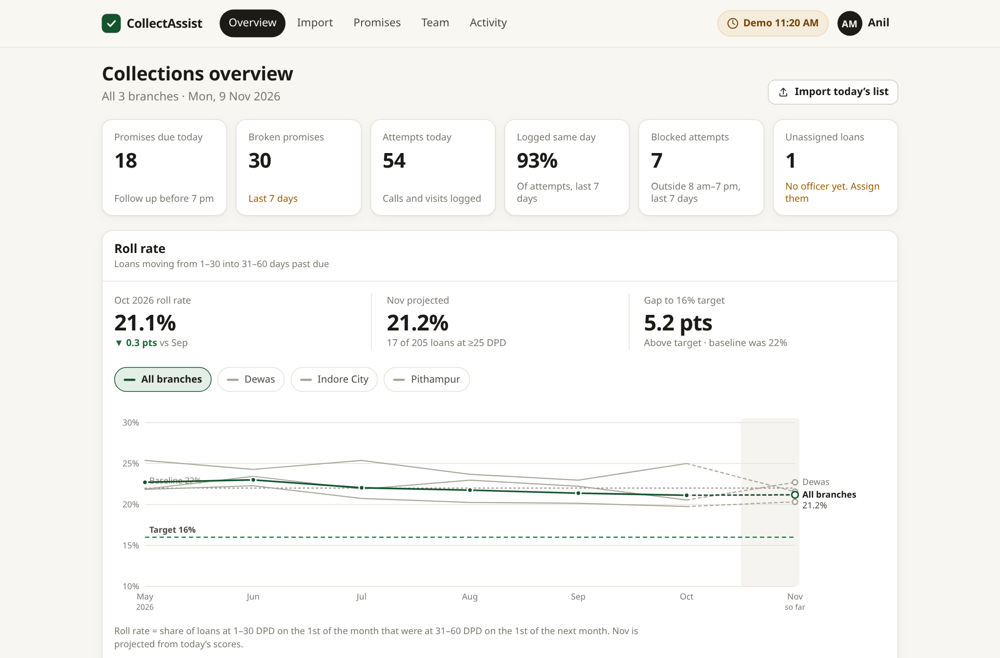

# CollectAssist

A field collections app for an MSME lender. Each officer opens the app and sees **which overdue borrowers matter most today, and why**. They log the outcome in three taps, even with no signal. Managers see **roll rates by branch** live instead of waiting for Friday's Excel.

Built for the "MSME lender's field collections app with AI prioritisation" brief (Company A, Indore).

**Live:** https://collect-assist.onrender.com (free hosting: the first load after idle takes ~40 s). Password `Demo@1234` for every account: officer `rahul@demo.in`, manager `manager.indore@demo.in`, head `head@demo.in`.

<p>
  
  
  
  
</p>


## What works end to end

| Slice | What it does |
|---|---|
| **Overdue CSV import and assignment** | Manager uploads the morning export. Rows are validated one by one with row-numbered errors. Loans are auto-assigned by pincode and workload (continuity first, then lightest load, then branch overflow), with a preview before committing. Loans missing from the file are closed as cured. |
| **Officer priority list** | Sorted by expected loss (chance of rolling into 31–60 DPD × balance × the brief's 20% NPA × 35% loss). Each loan shows its top three reasons in English or Hindi. Manager pins come first. Call and map buttons are on every card. |
| **Outcome logging** | Three taps: Log → Paid / Promise / Not reachable / Dispute → Save. GPS is captured, but saving never waits for it. |
| **Offline with sync** | Outcomes go to an IndexedDB outbox with a UUID made on the phone, then sync when there's signal. The server is idempotent on that UUID, so retries never duplicate. A service worker lets the app reopen with no signal. |
| **8 am – 7 pm contact block** | Enforced in the app and again on the server, using the time the attempt happened, in IST. Blocked attempts are still stored for audit. Borrower reminders are blocked outside the window too. |
| **Promise tracker** | Upcoming / due today / broken / kept. Reminders come only from approved templates, a word filter blocks threatening language, and nothing sends without a tap (sending is simulated). |
| **Manager roll-rate view** | Monthly roll rate by branch against the 22% baseline and 16% target, the current month projected from model scores, plus KPIs and a model back-test (AUC, top-20% capture, calibration). |

## The AI part

A logistic regression trained on six months of 1–30 DPD bucket history: days past due, near-roll flag, broken promises, share of dues paid, days since payment, balance and open promise. I chose it because the brief asks for a score **with reasons**. With a linear model each reason is that feature's exact share of the score. It is advisory: managers can pin loans, low-data loans are flagged as low confidence, and a back-test on held-out months shows whether it actually ranks well.

## Run it

```bash
npm install
npm run seed   # demo data
npm run dev    # http://localhost:5173
npm test       # unit + API tests
```

Demo password for every account: `Demo@1234`. Officer: `rahul@demo.in`, branch manager: `manager.indore@demo.in`, head: `head@demo.in`.
See [deployment.md](deployment.md) for full setup, environment variables and deployment.

## Stack

React 18 + Vite (installable PWA) · Express · SQLite (better-sqlite3) · Zod validation · Vitest + Supertest · TypeScript throughout. One shared `src/shared` folder holds the rules that both phone and server must agree on: IST contact window, scoring, assignment, reminder filter and API types.

```
src/
  shared/   pure logic + API types (tested)
  server/   Express API, SQLite schema, services, seed
  client/   React app: officer screens, manager screens, offline outbox
tests/      unit tests for the rules, API tests for access control and sync
docs/       API reference
```
